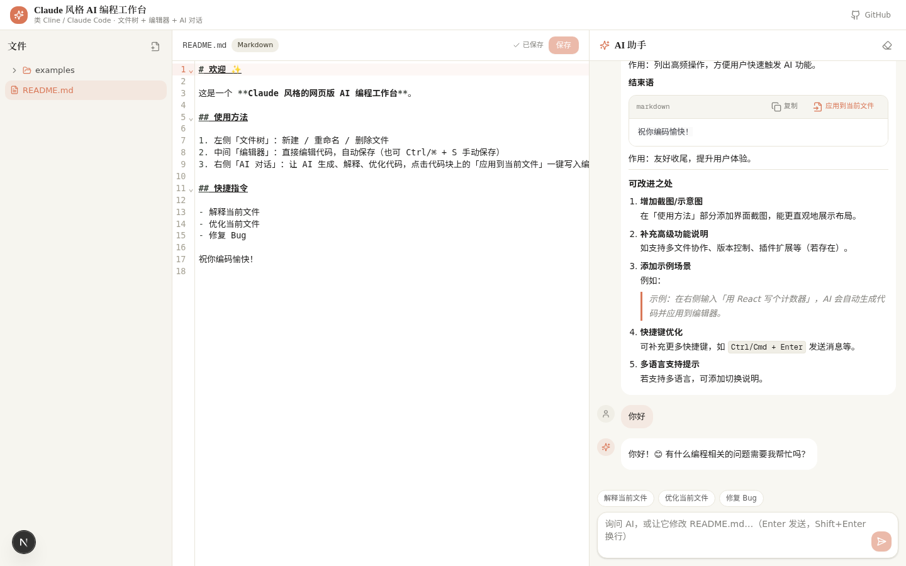

# Claude 风格 AI 编程工作台

> 类 Cline / Claude Code 的网页版 AI 编程助手 —— 左侧文件树 + 中间代码编辑器 + 右侧 AI 对话三栏布局。



## 功能特性

### 🗂 文件树（左栏）
- 新建文件（支持 `src/utils/helpers.ts` 形式的目录路径）、重命名 / 移动、删除（带确认）
- 目录树文件夹优先排序，展开 / 折叠状态持久化（刷新后保持）
- 激活文件高亮、未保存橙点标记

### ✏️ 代码编辑器（中栏）
- 基于 CodeMirror 6：语法高亮（JS/TS/Python/HTML/CSS/JSON/Markdown/SQL）、行号、括号匹配、自动补全
- **自动保存**：停止输入 1 秒后自动保存，`Ctrl/⌘ + S` 可手动立即保存；状态栏实时指示（已保存 / 未保存 / 保存中）与光标行列、选区统计
- 多标签页：**拖拽排序**、右键菜单（关闭其他 / 关闭右侧 / 关闭全部，脏标签自动保存）
- 编辑器内查找替换（`Ctrl/⌘ + F`）、Markdown 编辑 / 分屏 / 预览三模式
- 选中文本浮动工具条：让 AI 解释 / 优化 / 修复选中代码

### 🤖 AI 助手（右栏）
- 后端通过 `z-ai-web-dev-sdk` 调用 GLM 大模型实现代码**生成、解释、修改**，流式输出、可随时停止、可重新生成
- `@` 引用文件作为上下文（模糊搜索下拉），多轮对话持久化（SQLite / Prisma）
- 代码块操作：复制、插入到光标位置、**应用到文件**（选目标 → diff 预览 → 确认）、存为新文件、下载为本地文件；多代码块支持**批量应用**队列与「复制全部」
- Markdown 完整渲染：GFM 表格（对齐 / 横向滚动）、删除线、任务列表、语法高亮、超长代码块折叠
- 会话管理：多会话、置顶、搜索过滤、双击快速重命名、相对时间、清空 / 导出 Markdown（带时间戳）
- 快捷键：`Ctrl/⌘ + K` 命令面板（文件 / 会话 / 操作统一入口）、`Ctrl/⌘ + P` 快速打开、`Ctrl/⌘ + Shift + F` 全局搜索、`Ctrl/⌘ + /` 快捷键帮助

### 🎨 Claude 风格 UI
- 米白奶油底色（`#FAF9F5`）+ terracotta 陶土橙点缀（`#D97757`）
- 衬线标题字体、圆角卡片、简洁留白，支持**深色模式**
- 响应式：桌面端三栏可拖拽调整宽度（`react-resizable-panels`），移动端自动切换为 Tab 布局

## 技术栈

| 层 | 技术 |
| --- | --- |
| 框架 | Next.js 16（App Router）+ TypeScript 5 + React 19 |
| 样式 | Tailwind CSS 4 + shadcn/ui |
| 编辑器 | CodeMirror 6（@uiw/react-codemirror） |
| 数据库 | Prisma ORM + SQLite |
| AI | z-ai-web-dev-sdk（服务端调用） |
| 状态 | React Hooks（客户端） |

## 快速开始

```bash
bun install
bun run db:push   # 初始化 SQLite 数据库
bun run dev       # 开发模式，默认 3000 端口
```

打开首页即为工作台；首次加载会自动写入示例文件（README.md、examples/fibonacci.js、examples/hello.py）与欢迎消息。

## 项目结构

```
src/
├── app/
│   ├── api/
│   │   ├── chat/                # 聊天记录读写 + AI 流式调用（SSE）
│   │   ├── files/               # 文件 CRUD（列表 / 单文件）
│   │   ├── search/              # 全局搜索（文件名 + 内容）
│   │   ├── sessions/            # 会话 CRUD（重命名 / 置顶 / 删除）
│   │   └── export/              # 会话导出
│   ├── page.tsx                 # 工作台主页面（三栏编排 + 状态管理）
│   └── globals.css              # Claude 风格主题变量与自定义样式
├── components/workspace/
│   ├── file-tree.tsx            # 文件树（新建/重命名/删除/折叠持久化）
│   ├── code-editor.tsx          # CodeMirror 编辑器 + 多标签 + 右键菜单 + 拖拽排序
│   ├── chat-panel.tsx           # AI 对话面板 + 会话管理 + @ 引用
│   ├── ai-message.tsx           # Markdown/GFM 渲染 + 代码块操作
│   ├── apply-target-dialog.tsx  # 应用目标选择（键盘导航 + 批量队列）
│   ├── diff-dialog.tsx          # 应用前 diff 预览确认
│   ├── save-as-dialog.tsx       # 代码块存为新文件
│   ├── global-search.tsx        # 全局搜索
│   └── shortcuts-dialog.tsx     # 快捷键帮助
└── lib/
    ├── db.ts                    # Prisma 客户端
    ├── session.ts               # 默认会话保障
    ├── seed.ts                  # 首次启动种子数据
    └── language.ts              # 文件后缀 → 语言推断
```

## 更新日志

见 [CHANGELOG.md](CHANGELOG.md)。
